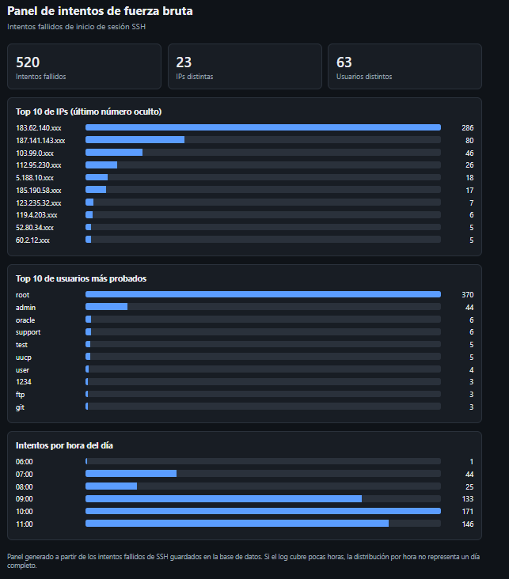

# Detector de fuerza bruta en logs SSH

Herramienta en Python que analiza logs de autenticación SSH, detecta direcciones IP con muchos intentos fallidos de inicio de sesión (posible ataque de fuerza bruta), los guarda en una base de datos SQLite y muestra los resultados en un panel con gráficos. Proyecto educativo de ciberseguridad.

## ¿Qué problema resuelve?

Un servidor expuesto a internet recibe intentos automáticos de adivinar usuarios y contraseñas. Cada intento queda registrado en el log, pero nadie puede leer miles de líneas a mano. Este programa las analiza y señala qué IPs están atacando.

## Características

**Versión 1: detector**
- Lee logs de autenticación SSH (formato `sshd` de Linux)
- Cuenta los intentos fallidos por IP y los usuarios más probados
- Marca como sospechosas las IPs que superan un umbral configurable
- Genera un reporte en pantalla y en `reporte.json`

**Versión 2: base de datos y panel**
- Guarda cada intento fallido en SQLite (`datos.db`)
- Evita duplicados: importar dos veces el mismo log no repite datos
- Resumen por consola: top de IPs, top de usuarios e intentos por hora
- Panel `panel.html` con gráficos, en un solo archivo y sin conexión a internet
- Las IPs se muestran con el último número oculto

**General**
- Sin dependencias externas: solo la biblioteca estándar de Python
- 31 pruebas automáticas con `unittest`

## Requisitos

- Python 3.8 o superior

## Uso

### Detector rápido

```bash
python detector.py auth.log
python detector.py auth.log --umbral 10
```

### Base de datos y panel

```bash
python almacen.py importar auth.log
python almacen.py resumen
python panel.py
```

Después abre `panel.html` en el navegador.

El repositorio incluye `auth.log`, un log de ejemplo para probarlo.

## Ejemplo de resultado (log de ejemplo)

```
Líneas leídas:      17
Intentos fallidos:  14

IPs sospechosas (umbral: 5 intentos):
  198.51.100.23    7 intentos
  203.0.113.5      6 intentos

Usuarios más probados:
  root       6
  admin      3
  test       1
  oracle     1
  ubuntu     1

Reporte guardado en reporte.json
```

## Resultados con datos reales

Probé el programa con una muestra de 2.000 líneas de un servidor OpenSSH real, del conjunto de datos público [Loghub](https://github.com/logpai/loghub).

| Métrica | Resultado |
|---|---|
| Líneas analizadas | 2.000 |
| Intentos fallidos detectados | 520 (26% de la muestra) |
| IPs distintas | 23 |
| Usuarios distintos | 63 |
| IPs sospechosas (umbral 5) | 10 |
| Intentos de esas 10 IPs | 496 (95% de los fallos) |
| Usuario más probado | `root`, con 370 intentos (71%) |



Las 5 IPs con más intentos (últimos números ocultos):

| IP | Intentos |
|---|---|
| 183.62.140.xxx | 286 |
| 187.141.143.xxx | 80 |
| 103.99.0.xxx | 46 |
| 112.95.230.xxx | 26 |
| 5.188.10.xxx | 18 |

**Qué muestran los datos:**
- Una sola IP concentra más de la mitad de los intentos, un patrón típico de herramientas automáticas.
- Casi todos los intentos vienen de muy pocas direcciones, por lo que bloquear unas pocas detendría gran parte del ataque.
- Los atacantes prueban sobre todo nombres de usuario comunes como `root`, `admin`, `support` y `oracle`.
- La muestra cubre solo unas 6 horas de un mismo día, así que la distribución por hora no representa un día completo.

**Un caso que encontré con datos reales:** el primer análisis contó 519 intentos en lugar de 520. Una línea tenía un usuario con un espacio extra y mi expresión regular no la reconocía. Corregí la plantilla y agregué una prueba para ese caso.

### Cómo reproducirlo

1. Descarga `OpenSSH_2k.log` desde la carpeta [OpenSSH de Loghub](https://github.com/logpai/loghub/tree/master/OpenSSH).
2. Colócalo en la carpeta del proyecto.
3. Ejecuta:

```bash
python almacen.py importar OpenSSH_2k.log
python almacen.py resumen
python panel.py
```

No incluyo el archivo en este repositorio; los datos pertenecen a sus autores.

### Fuente de los datos

Zhu, J., He, S., He, P., Liu, J., Lyu, M. R. *Loghub: A Large Collection of System Log Datasets for AI-driven Log Analytics.* IEEE ISSRE, 2023. <https://github.com/logpai/loghub>

## Cómo funciona

1. `detector.py` lee el log línea por línea y una expresión regular detecta las líneas `Failed password`, extrayendo la IP y el usuario.
2. `almacen.py` guarda cada intento en SQLite. Una restricción única (archivo + número de línea) evita duplicados al reimportar.
3. Las consultas calculan los totales, el top de IPs, el top de usuarios y los intentos por hora.
4. `panel.py` convierte esas consultas en un archivo HTML con gráficos de barras.

## Seguridad del propio programa

- Las consultas SQL usan parámetros, nunca texto concatenado, para evitar inyección SQL. Hay una prueba con un nombre de usuario malicioso.
- Todo texto que viene del log se escapa antes de mostrarse en el HTML, para evitar XSS. También hay una prueba.
- El panel no carga recursos externos.
- Las IPs se muestran con el último número oculto.

## Pruebas

```bash
python -m unittest -v
```

Las 31 pruebas verifican que el programa:
- extrae bien la IP y el usuario de cada intento fallido,
- reconoce nombres de usuario con espacios extra (caso encontrado con datos reales),
- ignora logins exitosos y líneas de otro tipo,
- respeta el umbral (5 por defecto, configurable),
- maneja archivos vacíos e inexistentes,
- no duplica datos al importar dos veces el mismo log,
- calcula correctamente los totales, los rankings y los intentos por hora,
- resiste nombres de usuario con código SQL o HTML malicioso,
- genera un panel sin recursos externos y con las IPs ocultas.

## Metodología

El proyecto se desarrolla escribiendo primero la especificación y verificándola después con pruebas automáticas: [`SPEC.md`](SPEC.md) para la versión 1 y [`SPEC_v2.md`](SPEC_v2.md) para la versión 2.

## Limitaciones

- Solo detecta y muestra: no bloquea IPs ni modifica el sistema.
- Solo entiende el formato de log de SSH en Linux.
- Un atacante que reparte pocos intentos entre muchas IPs puede quedar por debajo del umbral.
- El umbral por defecto (5) es arbitrario y debe ajustarse a cada caso.
- Los resultados con datos reales vienen de una muestra pequeña, no del conjunto completo.

## Próximos pasos

- Ubicación geográfica de las IPs
- Análisis de ataques capturados en un honeypot propio

## Aviso legal

Proyecto con fines educativos. Los logs de ejemplo usan IPs de rangos reservados para documentación. Úsalo solo con logs propios o de los que tengas autorización.

## Licencia

MIT
